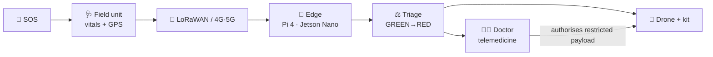

<div align="center">

# 🚁 Mission Sanjeevani

### AIoT-Enabled Emergency Medical Response Network

*Smart Connectivity. Intelligent Response. Saving Lives.*

[](https://github.com/GPMINNOVATORS/mission-sanjeevani/actions)
[](LICENSE)


**Hack for Social Cause · Youth Tech Challenge 2027** · Theme: Healthcare & Well-being

</div>

> ⚠️ **Research prototype, not a medical device.** Triage rules and payload protocols are placeholders that need clinical validation, and drone operations need regulatory approval (DGCA). See [SAFETY.md](SAFETY.md).

## The problem

In rural and flood-prone areas such as parts of Bihar, poor roads and distant hospitals delay emergency care. For road accidents, snakebites and pregnancy complications, the first hour decides the outcome. Four things go wrong: **delayed access**, **fragmented patient data**, **connectivity gaps** (cloud-only systems fail in weak coverage) and **slow coordination**.

## Our solution

Mission Sanjeevani links sensing, communication, intelligence and physical response into one emergency loop. The drone is the mobility layer, and the connected IoT ecosystem is the core innovation.



| Part | What it does | Code |
|---|---|---|
| Field unit | ASHA worker captures ECG, SpO₂, temperature, GPS | `firmware/` (planned) |
| Connectivity | LoRaWAN + 4G/5G, 17-byte uplink | `src/sanjeevani/lora_payload.py` |
| Triage | NEWS2-style vitals score + complaint escalation | `src/sanjeevani/triage.py` |
| Dispatch | Nearest viable drone by range, battery, ETA; payload by complaint | `src/sanjeevani/dispatch.py` |
| Control room | Web dashboard to assess a patient and plan dispatch | `src/sanjeevani/server.py` |
| Payload bay | Servo-latch state machine (Arduino/Tinkercad) | `firmware/prototype/` |
| Edge AI | ECG analysis, YOLOv8 landing-zone detection | `edge/` (under testing) |

## Challenge fit

| Challenge theme | Our fit |
|---|---|
| Healthcare & Well-being | Triage, telemedicine, medical kit delivery |
| Disaster Mitigation & Resilience | Works when floods cut roads and networks |
| AI, GIS & Emerging Technologies | Edge AI, GPS dispatch, LoRaWAN, drones |

**SDGs:** 3 (Good Health), 9 (Innovation & Infrastructure), 10 (Reduced Inequalities), 11 (Resilient Communities). Details and the impact-measurement plan: [docs/IMPACT.md](docs/IMPACT.md).

## Status: what works today

| ✅ Working now | 🔬 Under implementation & testing |
|---|---|
| Control-logic prototype (Arduino/Tinkercad) | AI-based ECG analysis |
| Rule-based triage + drone dispatch planner | YOLOv8 landing-zone detection |
| Web control-room dashboard | Edge-AI optimisation for offline use |
| LoRaWAN payload codec | Real field-unit hardware and flight tests |
| Response-time comparison model (assumption-based) | Autonomous navigation and landing |

## Quick start

```bash
git clone https://github.com/GPMINNOVATORS/mission-sanjeevani.git
cd mission-sanjeevani
pip install -e ".[dev]"
pytest
```

**Run the control-room dashboard** (no extra libraries needed):
```bash
sanjeevani serve
```
Open <http://127.0.0.1:8000>, click an example (Snakebite, Road accident, Pregnancy + bleeding) and press **Assess & plan dispatch**.

**Command line:**
```bash
sanjeevani triage examples/snakebite_report.json
sanjeevani compare --km 10        # illustrative road vs drone ETA
```

```
Triage    : ORANGE (score 6)
  - snakebite: time-critical, needs doctor guidance
Dispatch  : YES
  Drone D-01, payload snakebite_kit, 8.98 km, ETA 7.7 min
  * Payload release requires remote doctor authorisation.
```

**Hardware-logic prototype:** open [`firmware/prototype/sanjeevani_prototype/sanjeevani_prototype.ino`](firmware/prototype/sanjeevani_prototype/sanjeevani_prototype.ino) in the Arduino IDE or Tinkercad and use the serial monitor (`START` → `DROP` → `RESET`). See [firmware/prototype/README.md](firmware/prototype/README.md).

## Setup notes

- **Requirements:** Python 3.10+. No third-party runtime dependencies (standard library only). `pip install -e ".[dev]"` adds `pytest` and `ruff` for development.
- **Environment variables:** none required. Everything runs locally with defaults. (Future MQTT/LoRaWAN/API keys will be read from environment variables and documented here.)
- **Sample data:** [`examples/snakebite_report.json`](examples/snakebite_report.json)
- **Tests:** `pytest` (15 unit tests: triage, dispatch, LoRa codec, dashboard API, impact model)
- **Technical design document:** [docs/ARCHITECTURE.md](docs/ARCHITECTURE.md) (with architecture diagram)

## AI-assistance disclosure

We believe in being transparent about how this project was made.
- **Product AI:** the triage engine is currently **rule-based**. ECG-analysis AI and YOLOv8 landing detection are **under implementation and testing** and are not claimed as complete.
- **Development tools:** an AI assistant (Claude by Anthropic) helped draft the Python modules, documentation and presentation. The team designed, built and tested the hardware prototype and reviews all content.

## Repository layout

```
src/sanjeevani/      triage, dispatch, LoRa codec, impact model, dashboard, CLI
tests/               unit tests (15)
firmware/prototype/  Arduino control-logic prototype
edge/                ECG AI and YOLOv8 vision (planned)
connectivity/        LoRaWAN notes
docs/                architecture, roadmap, impact, submission guide, idea summary
examples/            sample patient reports
```

## Roadmap

| Now | Next | Then | Scale | Expand |
|---|---|---|---|---|
| IoT prototype + connected architecture | AI modules under testing | Edge AI + advanced ECG analytics | Multi-drone fleet + smart routing | Solar-hybrid rural charging stations |

Full task list: [docs/ROADMAP.md](docs/ROADMAP.md). Earlier pitch deck (Specathon, IoT theme): [docs/pitch/](docs/pitch/).

## Team

Students of **Government Polytechnic Madhubani**.

| Name | Role | GitHub |
|---|---|---|
| Aditya Kumar Raman | Team lead, hardware, Arduino | [@GPMINNOVATORS](https://github.com/GPMINNOVATORS) |
| Nairity Kumari | Hardware, software | [@GPMINNOVATORS](https://github.com/GPMINNOVATORS) |

Contact: missionsanjeevaniteam@gmail.com

## Contributing

Developers, clinicians, drone engineers and public-health practitioners are welcome. See [CONTRIBUTING.md](CONTRIBUTING.md). Starter tasks: [docs/PROTOTYPE_NOTES.md](docs/PROTOTYPE_NOTES.md).

## License

[MIT](LICENSE) © 2026 Mission Sanjeevani contributors
