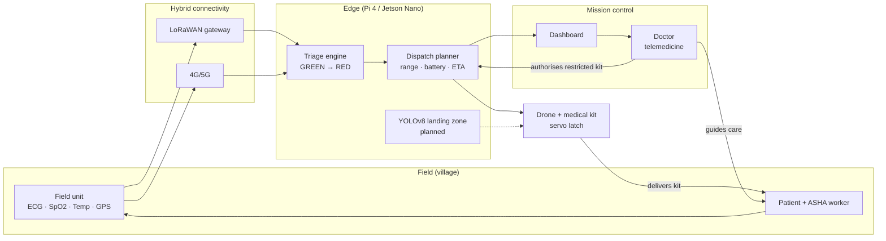

# Architecture

## Architecture diagram

**Principle:** keep critical intelligence close to the edge, and use hybrid connectivity so no single network is a point of failure.

## Pipeline

1. **Emergency**: SOS or event received (button, radio, call).
2. **Sense**: ECG, SpO₂, temperature (plus GPS and optional camera/atmospheric data) captured by the field unit.
3. **Connect**: LoRaWAN for long-range low-power uplink, 4G/5G when available, store-and-forward otherwise.
4. **Edge**: Raspberry Pi 4 / Jetson Nano process data locally, so the system still works with weak or no backhaul.
5. **AI**: ECG analysis for decision support and YOLOv8 for landing-zone detection (under testing).
6. **Respond**: Mission control (with doctor telemedicine) coordinates and authorises. The drone carries the kit.
7. **Deliver**: Payload released at the drop zone via the servo latch.

## Hardware stack

| Layer | Components |
|---|---|
| Sensing | ECG, SpO₂ (e.g. MAX30102), temperature |
| Control | ESP32, Raspberry Pi 4 |
| Connectivity | LoRaWAN, 4G/5G |
| Edge AI | Jetson Nano |
| Vision | Camera + YOLOv8 |
| Action | Drone + medical payload |

## Triage levels

| Level | Meaning | Action |
|---|---|---|
| GREEN | Non-urgent | Telemedicine advice |
| YELLOW | Semi-urgent | Monitor, plan transport |
| ORANGE | Urgent | Drone + doctor |
| RED | Critical | Immediate drone, top priority |

## Safety design

- Restricted payloads need **remote doctor authorisation** before release.
- If no drone is viable (range or battery), fall back to ambulance/helpline.
- Triage is advisory. A human always makes the final call.
